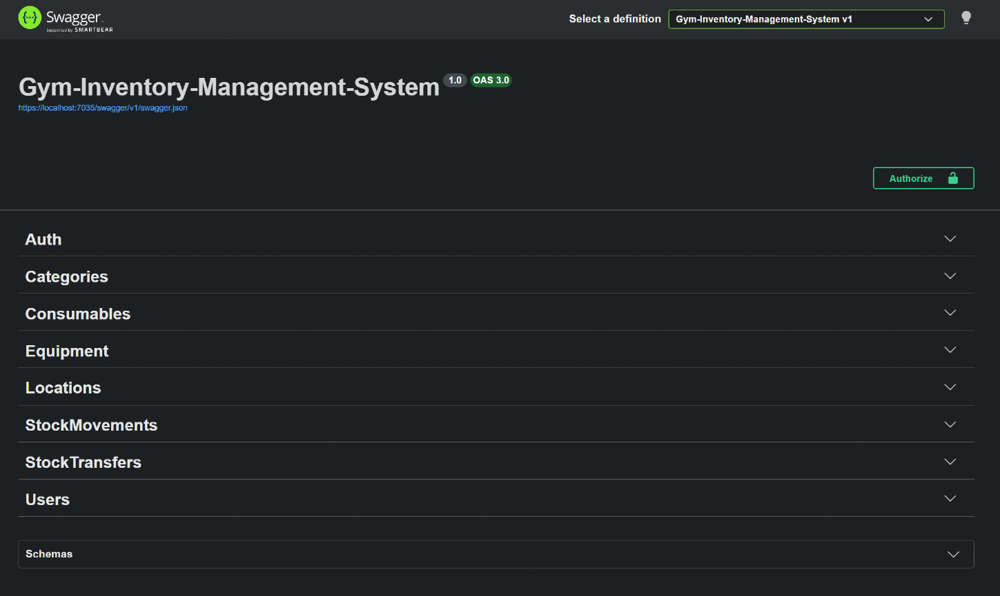

# Gym Inventory / Warehouse Management System

[](https://github.com/IbrahimAlShakak/Gym-Inventory-Management-System/actions/workflows/backend-ci.yml)

A backend-focused inventory and warehouse management system for a gym: it tracks equipment and consumables across multiple locations, records every stock change as history, and restricts who can do what through role-based authorization.

## API Preview



*Interactive API documentation (Swagger UI) with JWT Bearer authorization.*

## Tech Stack

- **Backend:** C# / ASP.NET Core Web API (.NET 10)
- **ORM:** Entity Framework Core
- **Database:** SQL Server
- **Auth:** JWT Bearer authentication, role-based authorization (Admin / Manager / Staff)
- **Testing:** xUnit integration tests (`WebApplicationFactory`) running against in-memory SQLite
- **CI:** GitHub Actions (build + full test suite on every pull request)
- **Frontend:** React *(planned)*

## Status

🚧 Work in progress. The backend is feature-complete for its core scope (inventory, stock tracking, users, auth) and covered by automated tests. A React frontend is planned.

## Repository Layout

```
.
├── .github/workflows/        # CI workflow
├── backend/
│   ├── Gym-Inventory-Management-System.slnx
│   ├── Gym-Inventory-Management-System/          # the API project
│   └── Gym-Inventory-Management-System.Tests/    # integration tests
└── frontend/                 # planned
```

## Features

### Domain model
- `Item` (abstract base) → `Equipment`, `Consumable` (Table-Per-Type inheritance)
- `Person` (abstract base) → `User`
- `Category`, `Location`
- `StockLevel`: current quantity snapshot per item and location
- `StockMovement`: append-only history of stock changes
- `StockTransfer`: stock moved between two locations

### Inventory and stock
- CRUD for Categories, Locations, Equipment and Consumables, with SKU and serial-number uniqueness enforced (duplicates return `409 Conflict`)
- **Stock movements:** `Received` and `Adjusted` add stock; `Used` and `Damaged` remove it. Each movement updates the matching `StockLevel` and is stored as history.
- **Stock transfers:** move stock between two locations; both `StockLevel` rows are updated in one save.
- **Stock can never go negative:** removing or transferring more than is available is rejected with `400` and leaves quantities unchanged.
- Read endpoints for current stock by item, by location, and by item + location, plus a low-stock consumables report
- The acting user of every movement and transfer is taken from the **JWT**, never from the request body, so a user cannot record actions as someone else.

### Users and authentication
- Password hashing via ASP.NET Core's `PasswordHasher<User>` (no plaintext passwords stored)
- JWT issuance on register and login, signed with a secret key kept in User Secrets (never committed)
- Public registration always creates a `Staff` user; roles can only be changed by an Admin
- User management (Admin / Manager): list and view users, create, update, change password, promote/demote, delete

### Roles

| Capability | Admin | Manager | Staff |
|---|:-:|:-:|:-:|
| Read categories, locations, equipment, consumables, stock levels | ✅ | ✅ | ✅ |
| Record stock movements and transfers | ✅ | ✅ | ✅ |
| Create / update categories, locations, equipment, consumables | ✅ | ✅ | ❌ |
| Delete categories, locations, equipment, consumables | ✅ | ❌ | ❌ |
| View users | ✅ | ✅ | ❌ |
| Create / update / delete / promote users, change passwords | ✅ | ❌ | ❌ |

### Error handling
Services throw specific exceptions and one global middleware turns them into consistent HTTP responses:

| Exception | Status |
|---|---|
| Validation failure (Data Annotations, automatic) | 400 |
| `InvalidOperationBusinessException` (e.g. insufficient stock, same-location transfer) | 400 |
| `InvalidLoginInput` | 401 |
| `NotFoundException` | 404 |
| `ConflictException` (e.g. duplicate SKU or username) | 409 |
| Anything unexpected | 500 |

### Swagger
Swagger is configured with Bearer token support, and enums are serialized as strings (matching how they are stored in the database).

## API Overview

| Area | Routes |
|---|---|
| Auth | `POST /api/auth/login`, `POST /api/auth/register` |
| Categories, Locations, Equipment, Consumables | `GET /api/{resource}`, `GET /api/{resource}/{id}`, `POST`, `PUT /{id}`, `DELETE /{id}` |
| Consumables (extra) | `GET /api/consumables/low-stock` |
| Stock movements | `GET /api/StockMovements/All-Stock-Movements`, `GET /api/StockMovements/Stock-Movement/{id}`, `POST /api/StockMovements` |
| Stock levels | `GET /api/Stock-Levels/Item/{itemId}`, `/Location/{locationId}`, `/Item/{itemId}/Location/{locationId}` |
| Stock transfers | `GET /api/StockTransfers/All-Stock-Transfers`, `/Stock-Transfer/{id}`, `/Stock-Transfers/Item/{itemId}`, `/Stock-Transfers/Locations/{from}/{to}`, `POST /api/StockTransfers/Stock-Transfer` |
| Users | `GET /api/users/all`, `GET /api/users/{id}`, `POST /api/users`, `PUT /api/users/update/{id}`, `PUT /api/users/promote/{id}`, `PUT /api/users/{id}/password`, `DELETE /api/users/{id}` |

## Getting Started

### Prerequisites
- .NET 10 SDK
- SQL Server (LocalDB or Express)
- `dotnet-ef` CLI tool (`dotnet tool install --global dotnet-ef`)

### Setup
All commands below run from the API project folder:

```bash
cd backend/Gym-Inventory-Management-System

# Restore dependencies
dotnet restore

# Apply database migrations
dotnet ef database update

# Set the JWT signing key (development secret, not committed to source control)
dotnet user-secrets set "Jwt:Key" "<a long random string, 32+ characters>"

# Run the app
dotnet run
```

On first run, the app seeds sample data automatically (categories, locations, items, users, stock levels, movements and transfers) if the database is empty.

### Seeded accounts (local development only)

| Username | Role |
|---|---|
| `ibrahim` | Admin |
| `sara`, `yousef`, `rana` | Manager |
| `omar`, `layla`, `nour`, `ahmad`, `khaled`, `dana` | Staff |

All seeded users use the password `Password123!`. These accounts exist for local testing; change or remove them before deploying anywhere real.

### Configuration
- Update the `DefaultConnection` string in `appsettings.json` to point to your local SQL Server instance.
- `Jwt:Issuer`, `Jwt:Audience` and `Jwt:ExpiryHours` are set in `appsettings.json`. `Jwt:Key` is kept out of source control and must be set via `dotnet user-secrets` (see Setup).

### Trying protected endpoints in Swagger
1. Call `POST /api/auth/login` with a username and password and copy the returned `token`.
2. Click **Authorize** in the Swagger UI and enter `Bearer <token>`.
3. Protected endpoints will now include the token automatically.

## Testing

The project has 140+ automated **integration tests** that start the real API in memory and call it over HTTP, so they exercise routing, authentication, authorization, validation, services, the database and the exception middleware together.

```bash
# from the repository root
dotnet test backend/Gym-Inventory-Management-System.slnx
```

(or use **Test Explorer** in Visual Studio)

**How the tests are set up**
- A custom `WebApplicationFactory` boots the app with a test JWT key and replaces SQL Server with an **in-memory SQLite** database, so tests need no external services and run in a few seconds.
- The database is created fresh and seeded on startup. Tests log in as the seeded Admin, Manager and Staff users and create their own data with unique values, so they don't depend on each other or on seed IDs.

**What is covered**
- Authentication: login, registration (always `Staff`, duplicate usernames, validation)
- Authorization: every endpoint rejects anonymous requests (`401`); role matrix for create, update and delete (`403` where not allowed)
- Validation (`400`), not-found (`404`) and conflict (`409`) behaviour for every resource
- Stock rules: movements change quantities correctly, stock can never go negative, transfers move stock atomically, same-location transfers are rejected
- Security: the acting user always comes from the token, even if the request body claims another user

**Known limitation:** SQLite and SQL Server differ in places (for example, text comparison is case-sensitive in SQLite). A future improvement is running the tests against a real SQL Server container.

## Continuous Integration

A GitHub Actions workflow (`.github/workflows/backend-ci.yml`) restores, builds and runs the full test suite on a clean Ubuntu machine for every pull request and every push to `main` that touches `backend/`.

## Design Notes

- **Equipment vs. Consumable** are separate subtypes (not a boolean flag) via EF Core's Table-Per-Type inheritance, since they need genuinely different fields.
- **StockLevel vs. StockMovement:** `StockMovement` is the append-only record of what happened, when and by whom; `StockLevel` is a cached current-quantity snapshot kept in sync with it, similar to how ledger systems track state.
- **Multi-location support** is built in from the start: every stock quantity and movement is tied to a specific `Location`.
- Enums (`MovementType`, `MaintenanceStatus`, `UserRole`) are stored as strings in the database for readability and safety against reordering.
- **Error handling is centralized:** services throw specific exceptions and a single middleware maps them to HTTP responses, avoiding scattered null checks and mismatched status codes.
- **Validation is layered:** Data Annotations on DTOs handle field-level rules (automatic `400`); business rules live in the service layer.
- **Authentication** uses hand-rolled JWT issuance (not ASP.NET Core Identity) with `PasswordHasher<User>`, kept deliberately lightweight for this project's scope. There are no refresh tokens, an intentional scope decision.
- **Least privilege by design:** public registration cannot create privileged users, and the roles are split so that only Admins can delete data or manage users.

## License

MIT, see [LICENSE.txt](LICENSE.txt).
